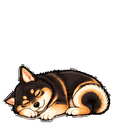
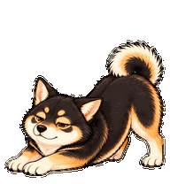

# くろ — ChatGPT Pet

自然な左右差を残した、黒・茶・クリームの柴犬イラスト風Petです。丸く眠り、作業中にはあくびしながら前足を伸ばします。




## ダウンロード

**Code → Download ZIP** で取得して展開するか、以下を実行してください。公開リポジトリなのでGitHubアカウントへのログインは不要です。

```sh
git clone https://github.com/Dragongame7/kuro-chatgpt-pet.git
cd kuro-chatgpt-pet
```

| ファイル | 利用先 | 仕様 |
| --- | --- | --- |
| [spritesheet-web-v1.png](assets/spritesheet-web-v1.png) | Webの手動アップロード | 1536×1872、透明PNG、9種類の動作 |
| [spritesheet-v2.png](assets/spritesheet-v2.png) | v2対応のPetsツール | 1536×2288、透明PNG、9種類の動作＋16方向の視線 |

v1は完成v2の先頭9行をそのまま切り出した互換版です。画像を再生成・引き伸ばししていません。いずれも検証済みです。

## 別のChatGPT Enterpriseアカウントで設定

### Web画面

1. 利用先のEnterpriseアカウントにログインし、対象ワークスペースを選びます。
2. **Settings → Personalization → Pet → Select pet** を開きます。
3. **Upload pet** で、ダウンロードした `assets/spritesheet-web-v1.png` を選びます。
4. 名前を「くろ」にします。説明欄があれば「丸く眠り、あくびしながらゆっくり伸びをする黒柴。自然な左右差のある手描き風イラスト。」を入力します。
5. 登録された「くろ」を選択します。

Webアップロード形式は1536×1872・20 MiB以下です。設定項目がない場合は、対象Enterprise環境でPetsを利用できるか管理者へ確認してください。[OpenAI公式Petsガイド](https://learn.chatgpt.com/docs/pets)（設定手順の確認日：2026-10-08）

GitHubの画像ページURLではなく、ダウンロードしたPNGファイルをアップロードします。

### v2対応のPetsツール

Petsプラグインの `validate_pet_spritesheet`、`prepare_pet_upload`、`create_pet` が使える環境では、`assets/spritesheet-v2.png` を添付して以下のように依頼できます。

```text
このスプライトシートを、このEnterpriseアカウントの個人用Pet「くろ」として登録し、選択してください。
画像は再生成せず、そのまま使用してください。
同じ画像の「くろ」が既に登録済みなら、そのPetを選んで重複登録を避けてください。
説明：丸く眠り、あくびしながらゆっくり伸びをする黒柴。自然な左右差のある手描き風イラスト。
```

ツールの提供状況はEnterprise環境によって異なります。利用先で新規登録すると、そのアカウント用のPet IDが発行されます。GitHubへの保存だけではEnterpriseへの登録は完了しません。

### デスクトップで表示

**Settings → Pets → Refresh** で一覧を更新し、「くろ」があれば選びます。`/pet` またはコマンドメニューの **Show pet** で表示します。一覧にない場合は、その環境で使える方法で登録してください。Webとデスクトップ間の自動同期は前提にしないでください。[公式Petsガイド](https://learn.chatgpt.com/docs/pets)

## 動作と保存内容

- [全動作GIF](previews/all-states.gif)／[MP4](previews/all-states.mp4)
- [寝姿→ジャンプ→寝姿](previews/idle-jump-idle.gif)
- [16方向の視線](previews/look-loop.gif)（v2）
- [コマ一覧](assets/final-contact-sheet.png)／[視線一覧](assets/directions.png)
- `sources/`：完成に使用した各動作・視線の元画像
- `qa/`：配置、透明背景、動作、視線、独立レビューの検証記録
- `checksums.sha256`：完成PNGの整合性確認用ハッシュ

動作のタイミングと速度はChatGPT側が制御します。画像だけで「チャット開始時に一度だけ伸びる」イベントを追加することはできません。

公開用の記録から端末の絶対パスとアカウント固有のPet情報を省いています。認証情報、アップロードセッション、一時ダウンロードURLは格納していません。

